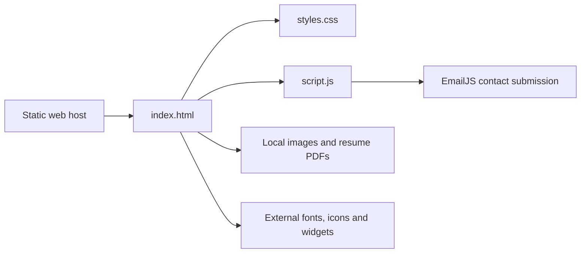

# Khuzaima Hassan — Portfolio

A personal portfolio presenting my AI/ML, data engineering, and LLM application work, alongside experience, education, credentials, and contact links.

**[Portfolio](https://khuzaimahassan.me)** · **[Vercel address listed on this repository](https://khuzaimahassan.vercel.app)** · **[GitHub profile](https://github.com/KhuzaimaHassan)**

The website is a static HTML, CSS, and vanilla JavaScript application. It has no frontend build step or package installation requirement. Project cards summarize implemented workflows; the linked project repositories contain setup instructions, evaluation evidence, and limitations. Demo availability depends on each project's hosting and external services.

## What visitors can explore

| Section in `index.html` | Content |
| --- | --- |
| `#home` | Concise introduction, Work / Resume actions, portrait, and social links |
| `#projects` | Four featured projects with repository screenshots; all ten remain available through filters |
| `#experience` | Experience cards |
| `#about` | Background, skills, résumé, and an expandable `#services` overview |
| `#education` | Degree and achievements, with earlier education in an expandable section |
| `#certifications` | Credential cards and available verification links |
| `#contact` | Contact details, social links, and an EmailJS contact form |

Project filters cover Featured, All, MLOps, Generative AI, Machine Learning, and Data Engineering. JavaScript handles the menu, accessible filter state, navigation highlighting, and contact submission. Core sections remain visible without JavaScript; all ten projects and the direct email link remain available. The mobile menu uses a 860 px breakpoint, and reduced-motion preferences disable smooth scrolling and hover motion.

See [UI verification](docs/UI_VERIFICATION.md) for the responsive checks and functional test command. The [project screenshot provenance](pic/projects/README.md) identifies the original captures; these are static repository images, rather than a live status feed.

Quasar's **Watch walkthrough** link opens an in-page video player with native playback/fullscreen controls, an **Open in new tab** option, and a text transcript. The 2:31 video uses the supplied narration, captions, slides, and real document-workflow captures. Its 6 MB MP4 loads only when opened; without JavaScript or native dialog support, the link opens the video directly. See [media notes](media/README.md) for scope and replacement instructions.

## Projects shown on the site

| Project | Implemented scope |
| --- | --- |
| [Logistics Forecasting](https://github.com/KhuzaimaHassan/logistics-forecasting-platform) | Demand and ETA inference, scheduled processing of a historical NYC Green TLC sample, Feast features, and an operations Copilot. Hosted Kafka/Valkey and local Redpanda/Redis are distinct configurations. |
| [Quasar](https://github.com/KhuzaimaHassan/Quasar) | Streaming multi-model chat, document answers with citations, memory, and agent workflows that pause for approval before execution. |
| [Voice Patient Registration](https://github.com/KhuzaimaHassan/voice-patient-registration) | Voice intake prototype: configured Vapi tool calls reach FastAPI validation and PostgreSQL persistence. Voice behavior depends on the external assistant configuration. |
| [Job Finder AI](https://github.com/KhuzaimaHassan/job-finder-ai) | Profile/resume matching, remote tech and Pakistan job search, application preparation, and application tracking with Next.js, FastAPI, Supabase, and Gemini. |
| [Risk Scoring Platform](https://github.com/KhuzaimaHassan/Risk-Scoring-Platform) | Educational demo with authenticated transaction scoring, saved prediction records, and a React analyst dashboard. Hosted admin credentials are private; see its performance guide for measured limits. |
| [10 Pearls AQI Predictor](https://github.com/KhuzaimaHassan/10-Pearls-AQI-Predictor) | Karachi AQI forecasting using Hopsworks features/models, hourly data jobs, and daily training workflows. |
| [AI Academic Mentor](https://github.com/KhuzaimaHassan/AI-Academic-Mentor) | OULAD classification and guidance retrieval combined in a LangGraph mentoring-report prototype. Suggested advice requires human review. |
| [Insight Agent](https://github.com/KhuzaimaHassan/Insight-Agent) | Streamlit exploration, charts, Gemini explanations from dataset samples/statistics, and HTML reports. |
| [Fraud Detection](https://github.com/KhuzaimaHassan/Fraud-Detection) | Evaluation of saved classifiers and a Streamlit demo; saved results are historical and local evaluation needs the required data/artifacts. |
| [Data Warehousing & BI](https://github.com/KhuzaimaHassan/Data-Warehousing-and-Business-Intelligence) | E-commerce ETL, dimensional modeling, clustering, and Power BI coursework. Existing warehouse results need customer-grain validation. |

These descriptions summarize repository implementations, rather than certifying production readiness or current demo uptime.

## How the site works



The contact form sends through EmailJS from the browser. It depends on the configured EmailJS account and network access; there is no contact API or mail server in this repository. External fonts, icons, EmailJS, and the feedback widget also depend on their providers. Local previews do not require sending a contact message.

## Run locally

With Git and Python 3 installed:

```bash
git clone https://github.com/KhuzaimaHassan/khuzaimahassan.github.io.git
cd khuzaimahassan.github.io
python -m http.server 8000 --bind 127.0.0.1
```

Open **http://localhost:8000/**. Reload after editing HTML, CSS, or JavaScript. Python's HTTP server does not provide automatic live reload.

Alternatively, the repository includes a dependency-free Node.js preview server:

```bash
node server.js
```

It uses port 8000, so run one preview server at a time. The Python command is the simplest documented preview path.

## Repository layout

```text
index.html          Main page and all portfolio sections
styles.css          Plain CSS, responsive layout and animation styles
script.js           Navigation, filters, animations and EmailJS submission
media/              Quasar walkthrough MP4, transcript and media notes
pic/                Profile and project screenshots
CV/                 Resume PDFs; index.html selects the download
about.html          Legacy redirect to the hosted #about section
projects.html       Legacy redirect to the hosted #projects section
resume.html         Legacy redirect to the hosted #about section
certifications.html Legacy redirect to the hosted #experience section
contact.html        Legacy redirect to the hosted #contact section
server.js           Optional Node.js preview server
firebase.json       Firebase Hosting settings
.firebaserc         Existing Firebase project alias
robots.txt          Crawler settings
sitemap.xml         Sitemap
LICENSE             MIT license
```

The legacy HTML files redirect to the custom domain even during a local preview. Use the anchors on the local `index.html` to inspect sections locally. There are no SASS source files, CSS compilation steps, or separate application pages behind those redirects.

## Hosting and updates

The canonical URL in the HTML is **https://khuzaimahassan.me**. GitHub repository metadata also lists the Vercel address linked above; this repository does not contain a Vercel deployment configuration or a committed deployment workflow.

Firebase Hosting configuration is included: `firebase.json` serves the repository root and `.firebaserc` names the existing `khuzaima-portfolio` project. An authorized maintainer can deploy using the Firebase CLI and `firebase deploy --only hosting` after selecting the intended project and reviewing the files served from the root. The CSS/JavaScript and image cache headers are set to one week.

The static files can also be served by GitHub Pages when Pages is configured in repository settings. The repository name alone does not establish that Pages is enabled, and a push to `main` is not a hosting-independent deployment command. Use the configured host's deployment process.

To update project presentation, edit the cards in `index.html` and the project table here together. Check each project's current source, documented demo URL, and evidence before adding performance or readiness claims.

## License

[MIT](LICENSE) · Khuzaima Hassan
